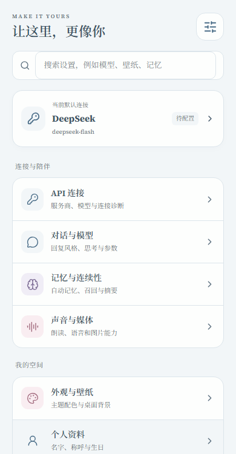
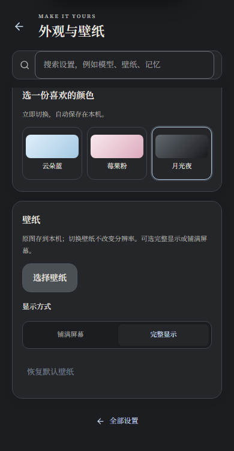
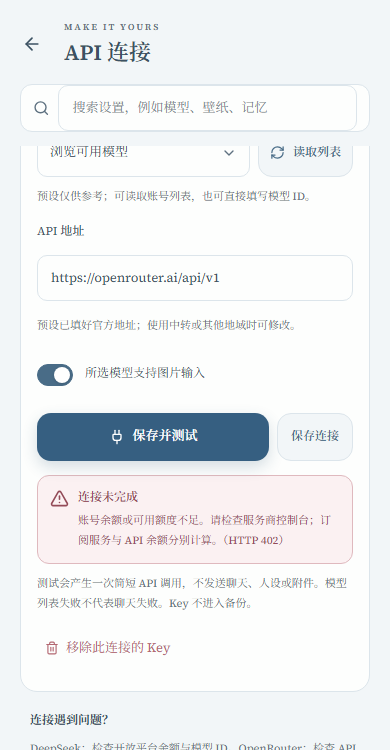
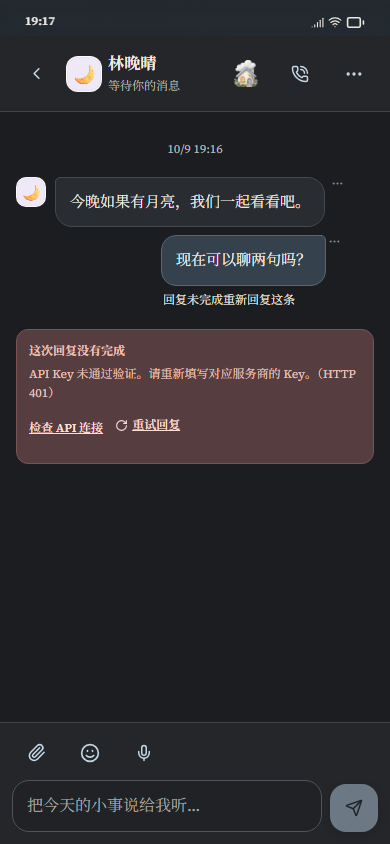

# 云笺听雨：API 连接修复与设置重设计

日期：2026-10-09。分析与修复基于 `main` 的 `eda4dde087bc9ddee23bfb254c3d2e136b3d4d09`。用户报告 DeepSeek、OpenRouter 偶发连接失败，有时没有可见错误。

本轮完成了已复现的地址处理、连接测试、错误传递和设置交互缺陷，并通过本地生产构建与自动化验收。真实账号的余额、权限和网络情况需要在用户环境验证；本轮没有使用真实 Key 或进行付费调用。

## 项目分析

项目包含 React 小手机界面、模型协议适配、本机 IndexedDB 数据与加密凭据、可选网页服务，以及 Android 原生网络桥接。Android 通过本机界面与原生桥直接访问服务商；网页服务通过对应 API 路由访问服务商。角色还可以覆盖全局模型连接。

这套结构已有角色卡、世界书、长期记忆、附件、媒体和备份能力。本次问题集中在五层：API 地址处理、凭据选择、流式错误解析、连接测试和可见反馈。网页与 Android 原先重复维护传输逻辑，容易出现相同错误在两端表现不同的情况。本轮抽出共享传输模块，让两端使用同一套地址、状态码和错误处理规则。

## 已确认的缺陷与修复

| 已确认的问题 | 用户会遇到什么 | 修复后的行为 |
| --- | --- | --- |
| 预设服务商忽略保存的自定义地址 | 修改 DeepSeek、OpenRouter 等地址后，请求仍去默认地址 | 所有预设均采用实际保存的地址；按所选协议调用 |
| 完整接口路径被再次拼接 | 粘贴 `/chat/completions`、`/models` 或 `/messages` 后地址错误 | 统一清理尾部路径与斜杠，再生成请求地址 |
| 流内错误被转换成笼统的“中断” | OpenRouter HTTP 200 中的错误难以判断，甚至看不到原因 | 识别流内错误及 `finish_reason: error`，显示安全的中文说明，不产生成功结束标记 |
| HTTP 错误在部分运行路径丢失状态 | 无法区分鉴权、余额、权限、限流与服务异常 | 网页与 Android 保留状态及分类说明；429 保留有效等待时间 |
| 模型发现与聊天连接混在一起 | `/models` 不可用时，被误认为完全不能聊天 | 手填模型 ID 始终可用；读取列表与聊天测试分别操作 |
| 连接测试经过角色和会话配置 | 测试全局连接，却实际使用了角色独立模型 | 用独立的两条测试消息、128 token 预算；关闭思考和额外惩罚参数，不发送聊天、人设与附件 |
| 全局自定义地址共用凭据槽位 | 换地址后可能带上旧地址的 Key | 全局凭据按服务商与规范化地址隔离；官方地址保持旧凭据兼容，自定义角色地址要求独立凭据 |
| 切换服务商重建整个设置页面 | 导航位置和诊断状态丢失 | 保留设置工作区，仅更新当前连接表单 |
| 失败原因只存在于临时界面 | 离开聊天或刷新后难以再检查 | 安全错误原因随失败消息保存；重试成功后清除；提供“检查 API 连接”入口 |

连接失败会分别说明 401 Key、402 余额/额度、403 权限、404 地址/模型、429 限流、参数不兼容、服务繁忙、HTML 登录页、网络错误及超时。OpenRouter 的临时并发预算和 Key 自身限额也分别提示。上游原始错误可能包含请求内容，本轮只展示经过分类的安全文本，不回显 Key 或完整请求。

连接测试支持取消、重试和耗时显示。输入 Key 不会自动发起请求；测试按钮会明确说明产生一次简短 API 调用。取消、离开分类或切换连接会终止相关请求，迟到的模型列表不会写入新页面。

## 设置的设计依据

参考了以下真实产品的组织方式，并延续云笺现有的云蓝、柔粉、月光夜主题与小手机风格：

- [SillyTavern API 连接](https://docs.sillytavern.app/usage/api-connections/openai/)与[连接配置](https://docs.sillytavern.app/usage/core-concepts/connection-profiles/)：服务商、模型、地址和连接测试属于同一个工作区；模型列表可选，允许手填 ID。
- [VS Code 设置](https://code.visualstudio.com/docs/configure/settings)：用分类和搜索定位功能，避免把所有设置堆在同一页。
- [Linear 偏好设置](https://linear.app/docs/account-preferences)：账户与外观等偏好按任务分组，让用户先找到目的，再看到具体控件。

据此采用“分类目录 → 单一任务页面”的结构。首页只显示当前连接摘要和八个入口；搜索支持服务商名与功能关键词，例如 OpenRouter、生日、壁纸、备份和上下文。

| 分类 | 主要内容 | 主要交互 |
| --- | --- | --- |
| API 连接 | 服务商、Key、模型、地址、诊断 | 搜索弹层、直接输入、明确操作按钮 |
| 对话与模型 | 回复风格、思考、上下文、群聊节奏 | 可见选项、分段按钮、滑杆 |
| 记忆与连续性 | 提取、召回、摘要与频率 | 开关、分段按钮 |
| 声音与媒体 | 朗读、语音、转写与图片 | 开关、直接选择、必要输入 |
| 外观与壁纸 | 三种主题、壁纸和显示方式 | 色卡、预览、分段按钮 |
| 个人资料 | 名字、称呼、生日 | 简洁表单 |
| 数据与备份 | 存储、导出、恢复、清理 | 状态说明与操作按钮 |
| 系统与扩展 | 核心提示词、音乐链接 | 专用编辑区与明确保存 |

少量互斥选项直接展示，布尔设置使用开关，大量服务商和模型使用带搜索的选择弹层。高级采样参数保留一个有明确标题的折叠区，避免进入日常设置就被参数淹没。设置页不再用层层折叠或下拉框承载所有内容。

分类切换保留未保存的模型、地址、采样参数、系统提示词和资料草稿；保存才修改需要确认的配置。立即生效的主题、频率等选项则在页面明确说明。分段控件支持方向键、Home/End；选择弹层支持 Escape 与焦点恢复。





## 其他界面的相关优化

聊天失败卡片增加直接检查连接与重试入口，刷新后仍可查看原因。暗夜操作文字对比度达到 4.5:1，操作高度至少 44px。角色独立 AI 设置使用可搜索的服务商选择，并明确独立 Key 的使用规则。首页连接标记改为准确的“Key 已保存”，不再把本地保存误称为网络已连接。

保持已有角色、世界书、壁纸原图、附件与备份行为；通过既有功能回归核对兼容性。本轮没有为其他应用加入新业务功能，也没有替换用户原有插画资源。





## 验收证据

全部服务商请求使用本地 fixture，经过真实业务适配和生产界面；没有调用真实付费 API。

| 检查 | 结果 | 证据 |
| --- | --- | --- |
| 核心逻辑回归，含 19 项新增连接回归 | 192 项通过 | [核心结果](api-settings-2026-10-09/core-validation-results.json) |
| 新设置、连接诊断、聊天恢复、原生桥接 | 23 项通过 | [连接界面结果](api-settings-2026-10-09/connection-ui-results.json) |
| 数据升级、附件、录音、媒体、独立角色模型、导航 | 17 项通过 | [功能结果](api-settings-2026-10-09/feature-regression-results.json) |
| 角色卡导入、AI 拆分和世界书 | 10 项通过 | [剧情结果](api-settings-2026-10-09/roleplay-regression-results.json) |
| 卡片仓库、编辑草稿、创建独立聊天角色 | 14 项通过 | [卡库结果](api-settings-2026-10-09/card-library-regression-results.json) |
| 异步保存、无效媒体、截断流与 PCM 拼接 | 10 项通过 | [可靠性结果](api-settings-2026-10-09/p0-reliability-results.json) |
| IndexedDB、5000 条历史、ZIP 备份和原子恢复 | 14 项通过 | [存储结果](api-settings-2026-10-09/storage-regression-results.json) |
| 严格 TypeScript，含未使用变量检查 | 通过 | 核心结果文件 |
| 网页 Vinext 生产构建 | 通过 | [构建结果](api-settings-2026-10-09/build-validation-results.json)，所有网页与 API 路由成功构建 |
| Android Web 界面生产构建 | 通过 | 同上；使用独立输出目录，不覆盖历史 APK 资源 |

共 280 项自动化检查通过，另有严格类型检查及两种生产构建。设置、选择弹层和聊天在 320、390、768、1440 宽度下检查无横向溢出；浏览器流程未出现页面运行错误。模拟原生桥接验证了 401 状态、流内 429 与取消请求的传递。

### 验证范围与发布状态

本轮交付源码、测试、设计报告和截图。没有使用真实 DeepSeek/OpenRouter 账号验证余额、模型权限、地域网络或服务商实时可用性；模拟桥接不等于真机验收。历史签名 APK、随包资源与签名材料未修改，本轮也未重新签署或安装 APK，因此已经安装的旧版本不会自动包含这些修改。

生产构建保留了现有 Three.js 大分块提示，不影响本轮构建通过。历史 APK 的整体二进制完整性门禁未在本轮源码快照上重跑；原有历史二进制的清单值保留。仓库文件索引仅更新本轮改动和新增文件的大小与摘要。

按本轮使用本地验证的偏好，不主动查询或运行 GitHub Actions。草稿提交使用 `[skip ci]` 避免现有 push / pull_request 验证流程自动运行；这符合 [GitHub 跳过工作流的约定](https://docs.github.com/en/actions/how-tos/manage-workflow-runs/skip-workflow-runs)。后续安装候选应从这些源码构建，使用原签名，并完成真机与真实账号验收。

## 维护与复现

核心改动位于 `lib/providers.ts`、`provider-errors.ts`、`provider-transport.ts`、`provider-adapter.ts`、网页 API 路由与 `android-web/runtime.ts`。连接表单位于 `app/connection-settings.tsx`，设置目录位于 `app/settings.tsx`，共享选择控件位于 `app/setting-controls.tsx`。新增检查已接入正常核心与浏览器验收入口。

在仓库根目录安装原有锁定依赖后，可运行：

```sh
node outputs/mori-phone/scripts/verify-connections.mjs
python3 work/check-release.py
node outputs/mori-phone/node_modules/vite/bin/vite.js build --config outputs/mori-phone/android-web/vite.config.ts --outDir ../../../work/feature-build
node work/qa/connection-ui.mjs
node work/qa/features.mjs
node work/qa/roleplay.mjs
node work/qa/card-library.mjs
node work/qa/p0-reliability.mjs
node work/qa/storage.mjs
```

网页生产构建从 `outputs/mori-phone` 运行 `npm run build`。浏览器位置可由 `PLAYWRIGHT_CHROMIUM_EXECUTABLE_PATH` 指定；连接测试的构建和报告目录可用 `CONNECTION_BUILD_DIR`、`CONNECTION_OUTPUT_DIR` 指定。

官方协议核对来源：[DeepSeek API](https://api-docs.deepseek.com/en/)、[DeepSeek 错误码](https://api-docs.deepseek.com/quick_start/error_codes/)、[OpenRouter 官方错误处理文档](https://github.com/OpenRouterTeam/docs/blob/main/api_reference/errors-and-debugging.mdx)。
